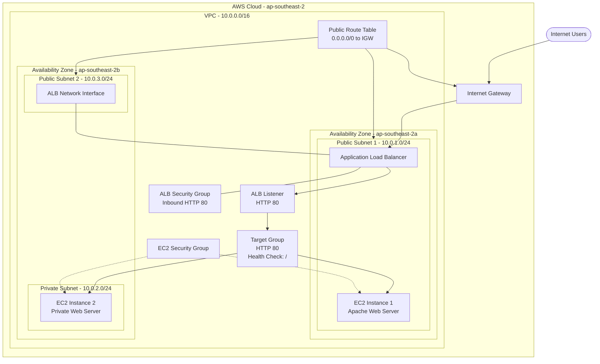
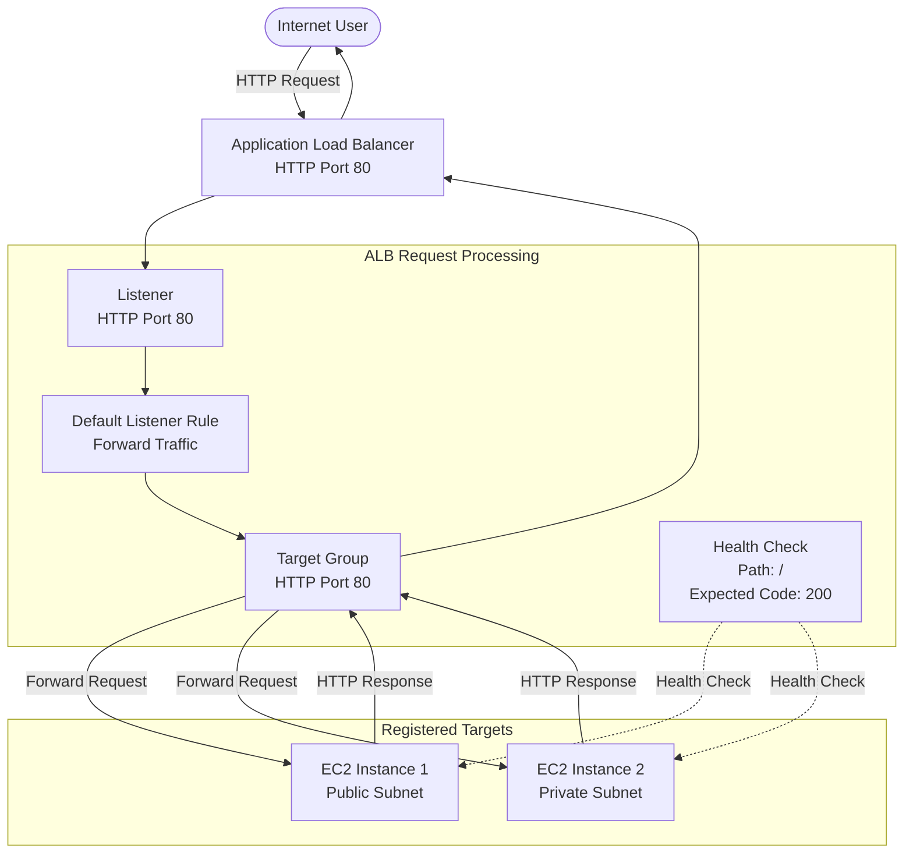

# AWS Application Load Balancer Architecture using Terraform

## Project Overview

This project demonstrates how to provision AWS infrastructure using Terraform.

The architecture uses an Application Load Balancer (ALB) to distribute incoming HTTP traffic across EC2 instances deployed in different subnets.

The infrastructure is created using Infrastructure as Code (IaC) with Terraform.

## Architecture Components

The project includes the following AWS resources:

- **VPC:** Custom Virtual Private Cloud with CIDR `10.0.0.0/16`.
- **Public Subnets:** Two public subnets deployed across different Availability Zones.
- **Private Subnet:** A private subnet for an EC2 instance.
- **Internet Gateway:** Provides internet connectivity to public subnets.
- **Route Table:** Routes public subnet traffic through the Internet Gateway.
- **Security Groups:** Controls inbound and outbound traffic.
- **EC2 Instances:** Two EC2 instances hosting the application.
- **Application Load Balancer:** Distributes incoming HTTP traffic.
- **Target Group:** Registers EC2 instances and performs health checks.
- **Listener:** Listens on HTTP port 80 and forwards traffic to the target group.

## AWS Services Used

- Amazon VPC
- Amazon EC2
- Application Load Balancer
- Security Groups
- Internet Gateway
- Route Tables
- AWS IAM

## Tools and Technologies

- Terraform
- AWS CLI
- Linux (Ubuntu)
- Git
- GitHub

## Project Structure

```text
aws-terraform-alb-architecture/
├── .gitignore
├── .terraform.lock.hcl
├── main.tf
├── output.tf
├── provider.tf
├── user_data1.sh
├── user_data2.sh
└── variable.tf
```

## Deployment Steps

### 1. Clone the Repository

```bash
git clone https://github.com/Rinku20122002/aws-terraform-alb-architecture.git
```

### 2. Navigate to the Project Directory

```bash
cd aws-terraform-alb-architecture
```

### 3. Initialize Terraform

```bash
terraform init
```

### 4. Format Terraform Configuration

```bash
terraform fmt
```

### 5. Validate Configuration

```bash
terraform validate
```

### 6. Review Execution Plan

```bash
terraform plan
```

### 7. Deploy Infrastructure

```bash
terraform apply
```

Type `yes` when Terraform asks for confirmation.

### 8. Access the Application

After deployment, retrieve the ALB DNS name:

```bash
terraform output alb_dns
```

Open the DNS name in a browser using HTTP.

## Cleanup

To avoid unnecessary AWS charges, destroy the infrastructure after testing:

```bash
terraform destroy
```

Type `yes` to confirm.

## Important Notes

- The ALB is configured in two public subnets across different Availability Zones.
- One EC2 instance is deployed in a public subnet and another in a private subnet.
- A NAT Gateway is not configured in this project.
- The private EC2 instance may require an alternative method for downloading application packages.
- Check EC2 target health before expecting traffic to reach both instances.
- Review Security Group rules before deploying this project in a production environment.

## Learning Objectives

Through this project, I practiced:

- AWS VPC and subnet configuration.
- Public and private subnet concepts.
- Internet Gateway and route table configuration.
- EC2 provisioning using Terraform.
- Application Load Balancer configuration.
- Target Groups and Health Checks.
- Security Group configuration.
- Terraform variables and outputs.
- Infrastructure deployment and cleanup.

---

## AWS Architecture Diagram

The following diagram illustrates the complete AWS infrastructure, including networking, security, load balancing and compute resources.



## ALB Request Flow

This diagram explains how incoming HTTP requests are processed by the Application Load Balancer.



**Author:** Rinku Yadav

**GitHub:** https://github.com/Rinku20122002